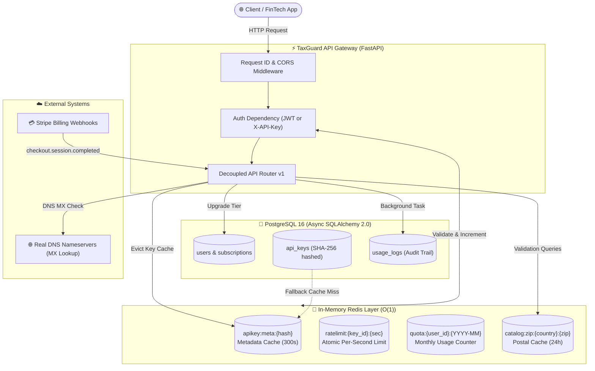

# 🛡️ TaxGuard API — B2B Data & Fiscal Validation Micro-SaaS

[](https://github.com/Edgar-Cbr/TaxGuard-API-/actions/workflows/ci.yml)
[](https://fastapi.tiangolo.com)
[](https://www.python.org/)
[](https://www.postgresql.org/)
[](https://redis.io/)
[](https://www.docker.com/)
[](https://opensource.org/licenses/MIT)

> **High-performance, production-grade B2B Micro-SaaS API** designed for FinTechs, ERPs, and Neobanks to validate onboarding compliance: fiscal identifiers (Mexican RFC with SAT Modulo 11 checksum), sub-10ms postal code catalogs, and corporate email screener with real DNS MX verification.

---

## 📑 Table of Contents

- [Executive Overview](#-executive-overview)
- [System Architecture](#-system-architecture)
- [Key Engineering Highlights](#-key-engineering-highlights)
- [Database Schema & Redis Cache Layout](#-database-schema--redis-cache-layout)
- [Repository Structure](#-repository-structure)
- [Quickstart with Docker Compose](#-quickstart-with-docker-compose)
- [API Reference & cURL Examples](#-api-reference--curl-examples)
- [Testing & Code Quality](#-testing--code-quality)
- [CI/CD Automation](#-cicd-automation)
- [License](#-license)

---

## ⚡ Executive Overview

Modern B2B onboarding suffers from high drop-off rates and fraud due to manual or delayed fiscal verification. **TaxGuard API** is built to solve this at scale:

* **Instant Verification:** Validates Mexican RFCs (individuals, legal entities, and generic public) with mathematical Modulo 11 check digit verification and calendar date consistency (preventing impossible dates like February 30).
* **Sub-10ms Postal Code Resolution:** Resolves country postal codes to state, municipality, and settlement lists with a 24-hour Redis memory cache.
* **Corporate Email Deliverability Screening:** Screens out disposable inboxes and free public webmails while performing non-blocking DNS MX lookups.
* **Carrier-Grade Rate Limiting:** Enforces per-second sliding window limits and monthly quota consumption in Redis with atomic pipelines, injecting standard `X-RateLimit-*` and `X-Quota-Remaining` headers.
* **Asynchronous Audit Logging:** Captures response latency and status codes via FastAPI `BackgroundTasks` without blocking response delivery.
* **Stripe Webhook Integration:** Automates real-time subscription tier migration (`FREE` $\rightarrow$ `PRO`) with atomic Redis cache eviction.

---

## 🏗️ System Architecture



---

## 💎 Key Engineering Highlights

### 1. Sliding Window Rate Limiting & Atomic Quotas
* Evaluated entirely in **Redis** before querying relational storage.
* Executes atomic multi-command pipelines (`INCR` + `EXPIRE`).
* Emits standard RFC rate limit headers:
  * `X-RateLimit-Limit`: Maximum requests allowed per second.
  * `X-RateLimit-Remaining`: Remaining capacity in the current second window.
  * `X-Quota-Remaining`: Calls remaining in the current calendar month.
* When limits are reached, immediately yields `429 Too Many Requests` with a dynamic `Retry-After` header.

### 2. Cryptographic API Key Lifecycle
* API Keys follow the format `tg_live_<32_hex_chars>`.
* **Zero plaintext storage:** Only the `SHA-256` hash and a 10-character prefix (`tg_live_XX...`) are persisted.
* Cached in Redis for 300 seconds (`apikey:meta:{key_hash}`).
* Revocation immediately triggers transactional database updates and cache invalidation.

### 3. Mexican Fiscal ID (RFC) Verification Engine
* Full support for **Persona Moral** (12 alphanumeric chars), **Persona Física** (13 alphanumeric chars), and **Público General** (`XAXX010101000`).
* Validates Gregorian date consistency against calendar leap years.
* Computes the official Mexican SAT **Modulo 11 check digit** using the official 3-character homoclave table.

### 4. Asynchronous Background Consumption Audit
* Endpoint handlers dispatch asynchronous audit tracking via FastAPI `BackgroundTasks`.
* Logs exact millisecond latency, HTTP status code, API Key identifier, and UTC timestamp into `usage_logs`.
* Does not block or increase client request round-trip time.

---

## 🗄️ Database Schema & Redis Cache Layout

### PostgreSQL Tables

| Table | Primary Key | Description |
| :--- | :--- | :--- |
| `users` | `UUID` (v4) | Stores account credentials (bcrypt hashed), active status, and tier (`FREE`, `PRO`, `ENTERPRISE`). |
| `subscriptions` | `UUID` (v4) | Tracks Stripe customer ID, monthly quota (1,000 Free / 50,000 Pro), and rate limits (5 req/s Free / 50 req/s Pro). |
| `api_keys` | `UUID` (v4) | Stores `key_prefix`, `key_hash` (unique SHA-256 index), `is_active`, `revoked_at`, and `last_used_at`. |
| `usage_logs` | `BIGSERIAL` | Time-series audit log capturing `endpoint`, `status_code`, `latency_ms`, and `created_at`. |

### Redis Keys

* **`apikey:meta:{key_hash}`** $\rightarrow$ JSON metadata cache (`TTL: 300s`).
* **`ratelimit:{api_key_id}:{epoch_second}`** $\rightarrow$ Atomic sliding second counter (`TTL: 1s`).
* **`quota:{user_id}:{YYYY-MM}`** $\rightarrow$ Monthly consumption counter (`TTL: 35 days`).
* **`catalog:zip:{country}:{postal_code}`** $\rightarrow$ Postal code directory cache (`TTL: 24h`).

---

## 📁 Repository Structure

```text
taxguard-api/
├── .github/
│   └── workflows/
│       └── ci.yml                 # Automated Ruff linter & Pytest suite
├── app/
│   ├── api/
│   │   ├── deps.py                # Dependency injection (DB, Redis, JWT, X-API-Key)
│   │   └── v1/
│   │       ├── endpoints/
│   │       │   ├── auth.py        # Registration, login, /me profile
│   │       │   ├── keys.py        # Key creation, listing, revocation, usage analytics
│   │       │   ├── validators.py  # Tax ID, postal code, email, and batch validation
│   │       │   └── billing.py     # Stripe checkout webhook integration
│   │       └── router.py          # Unified v1 API router
│   ├── core/
│   │   ├── config.py              # Pydantic Settings reading .env
│   │   ├── security.py            # Bcrypt, JWT tokens, and SHA-256 API key hashing
│   │   ├── rate_limit.py          # Redis sliding-window & quota enforcement engine
│   │   └── exceptions.py          # RFC 7807 compliant standardized exception handlers
│   ├── db/
│   │   ├── base.py                # SQLAlchemy 2.0 DeclarativeBase and mixins
│   │   ├── session.py             # AsyncEngine & async_sessionmaker setup
│   │   └── migrations/            # Alembic async migration environment
│   ├── models/                    # ORM entities (User, Subscription, ApiKey, UsageLog)
│   ├── schemas/                   # Pydantic v2 DTOs and validation models
│   ├── services/                  # Pure domain logic (RFC, Postal, Email, UsageTracker)
│   └── main.py                    # Application factory, lifespan, CORS, and healthcheck
├── tests/
│   ├── conftest.py                # AsyncClient fixtures, in-memory DB & Redis mock
│   ├── test_health.py             # Healthcheck and middleware tests
│   ├── test_models.py             # SQLAlchemy model initialization & constraint tests
│   ├── test_auth_and_keys.py      # JWT authentication and key rotation tests
│   ├── test_rate_limiting.py      # Redis rate limiting & quota exhaustion tests
│   ├── test_validators.py         # Tax ID, postal code, and email validation tests
│   ├── test_audit_and_billing.py  # Background logging and Stripe webhook tests
│   └── test_e2e_integration.py    # Complete Micro-SaaS lifecycle integration test
├── Dockerfile                     # Multi-stage lightweight production container
├── docker-compose.yml             # Local orchestration (FastAPI + Postgres 16 + Redis 7)
├── pyproject.toml                 # Dependencies, Ruff & Pytest configurations
└── README.md                      # Executive documentation
```

---

## 🚀 Quickstart with Docker Compose

### 1. Clone & Configure Environment

```bash
git clone https://github.com/Edgar-Cbr/TaxGuard-API-.git
cd TaxGuard-API-
cp .env.example .env
```

### 2. Start Services

Launch the complete stack (FastAPI app, PostgreSQL 16, and Redis 7):

```bash
docker compose up --build -d
```

### 3. Verify Health & Connectivity

```bash
curl -X GET http://localhost:8000/health
```

**Expected Response (`200 OK`):**
```json
{
  "status": "healthy",
  "environment": "development",
  "version": "0.1.0",
  "database": "connected",
  "redis": "connected",
  "timestamp": "2026-10-24T06:30:00Z"
}
```

The interactive Swagger documentation is available at `http://localhost:8000/docs`.

---

## 📡 API Reference & cURL Examples

### 1. Register Account & Generate API Key

```bash
# Register
curl -X POST http://localhost:8000/api/v1/auth/register \
  -H "Content-Type: application/json" \
  -d '{"email": "cto@fintech.io", "password": "SuperSecretPassword123!"}'

# Login to obtain Bearer JWT
TOKEN=$(curl -s -X POST http://localhost:8000/api/v1/auth/login \
  -H "Content-Type: application/json" \
  -d '{"email": "cto@fintech.io", "password": "SuperSecretPassword123!"}' | jq -r .access_token)

# Generate Production API Key
API_KEY=$(curl -s -X POST http://localhost:8000/api/v1/keys \
  -H "Authorization: Bearer $TOKEN" \
  -H "Content-Type: application/json" \
  -d '{"name": "Production Invoicing"}' | jq -r .api_key)

echo "Your API Key is: $API_KEY"
```

---

### 2. Validate Mexican Fiscal ID (RFC)

```bash
curl -i -X POST http://localhost:8000/api/v1/validate/tax-id \
  -H "X-API-Key: $API_KEY" \
  -H "Content-Type: application/json" \
  -d '{"tax_id": "BBA830831LJ2"}'
```

**Response (`200 OK`):**
```http
HTTP/1.1 200 OK
content-type: application/json
X-RateLimit-Limit: 5
X-RateLimit-Remaining: 4
X-Quota-Remaining: 999
X-Request-ID: e6b45a27-7e61-464e-b52b-7c39fd9a1e0b

{
  "tax_id": "BBA830831LJ2",
  "valid": true,
  "entity_type": "LEGAL_ENTITY",
  "normalized_id": "BBA830831LJ2",
  "registration_date": "1983-08-31",
  "checksum_valid": true,
  "errors": []
}
```

---

### 3. Validate Postal Code

```bash
curl -i -X POST http://localhost:8000/api/v1/validate/postal-code \
  -H "X-API-Key: $API_KEY" \
  -H "Content-Type: application/json" \
  -d '{"postal_code": "06000", "country_code": "MX"}'
```

**Response (`200 OK`):**
```json
{
  "postal_code": "06000",
  "country_code": "MX",
  "valid": true,
  "state": "Ciudad de México",
  "municipality": "Cuauhtémoc",
  "city": "Ciudad de México",
  "settlements": ["Centro (Área 1)"],
  "cached": true
}
```

---

### 4. Validate Corporate Email

```bash
curl -i -X POST http://localhost:8000/api/v1/validate/corporate-email \
  -H "X-API-Key: $API_KEY" \
  -H "Content-Type: application/json" \
  -d '{"email": "compliance@stripe.com", "check_dns": true}'
```

**Response (`200 OK`):**
```json
{
  "email": "compliance@stripe.com",
  "valid": true,
  "domain": "stripe.com",
  "is_corporate": true,
  "is_disposable": false,
  "is_free_provider": false,
  "has_mx_records": true,
  "mx_hosts": ["mxa-0014b201.gslb.pphosted.com"],
  "errors": []
}
```

---

### 5. High-Throughput Batch Validation

```bash
curl -X POST http://localhost:8000/api/v1/validate/batch \
  -H "X-API-Key: $API_KEY" \
  -H "Content-Type: application/json" \
  -d '{
    "tax_ids": ["BBA830831LJ2", "XAXX010101000", "INVALID_RFC"],
    "postal_codes": ["06000", "99999"],
    "emails": ["cto@company.com", "user@mailinator.com"]
  }'
```

---

### 6. Query Usage Analytics & Metrics

```bash
curl -X GET http://localhost:8000/api/v1/keys/usage \
  -H "Authorization: Bearer $TOKEN"
```

**Response (`200 OK`):**
```json
{
  "total_calls": 5,
  "avg_latency_ms": 11.45,
  "status_codes": {
    "200": 4,
    "422": 1
  },
  "monthly_quota": 1000,
  "quota_remaining": 995,
  "tier": "FREE"
}
```

---

### 7. Stripe Plan Upgrade Webhook

```bash
curl -X POST http://localhost:8000/api/v1/billing/webhook \
  -H "Content-Type: application/json" \
  -d '{
    "id": "evt_live_test_01",
    "type": "checkout.session.completed",
    "data": {
      "object": {
        "id": "cs_live_session_123",
        "customer": "cus_enterprise_999",
        "client_reference_id": "<USER_UUID>",
        "customer_email": "cto@fintech.io"
      }
    }
  }'
```

**Response (`200 OK`):**
```json
{
  "status": "success",
  "tier": "PRO",
  "monthly_quota": 50000,
  "rate_limit_per_sec": 50,
  "message": "User plan upgraded to PRO successfully."
}
```

---

## 🧪 Testing & Code Quality

The test suite runs with an in-memory SQLite database (`aiosqlite`) and an isolated Redis mock, requiring zero external services to execute locally or in CI pipelines.

```bash
# Activate virtual environment
source .venv/bin/activate  # Or .venv\Scripts\activate on Windows

# Run full test suite
pytest -v

# Run code style and lint check
ruff check .

# Check formatting compliance
ruff format --check .
```

### Test Coverage Breakdown

* **`tests/test_health.py`**: Healthcheck introspection and request ID correlation headers.
* **`tests/test_models.py`**: SQLAlchemy 2.0 ORM constraints, foreign keys, cascade deletes, and table indices.
* **`tests/test_auth_and_keys.py`**: Bcrypt password hashing, JWT authorization, cryptographic key prefixing, and revocation.
* **`tests/test_rate_limiting.py`**: Redis sliding window limits, atomic quota decrement, and `429 Too Many Requests` behavior.
* **`tests/test_validators.py`**: SAT Modulo 11 check digits, impossible calendar dates, postal code cache, and MX DNS resolution.
* **`tests/test_audit_and_billing.py`**: Asynchronous `BackgroundTasks` audit writing, usage metric aggregation, and Stripe plan upgrades.
* **`tests/test_e2e_integration.py`**: Complete end-to-end integration test spanning registration to key rotation and upgraded limits.

**Total Tests:** **49 passed (100% success rate)**.

---

## 🔄 CI/CD Automation

Every `push` and `pull_request` to `main` and `develop` triggers the GitHub Actions workflow [`.github/workflows/ci.yml`](.github/workflows/ci.yml):

1. **Lint Job:** Executes `ruff check .` and `ruff format --check .`.
2. **Test Job:** Sets up Python 3.12, installs dependencies, and runs `pytest -v`.

---

## 📄 License

This project is licensed under the terms of the [MIT License](LICENSE).

Developed with ❤️ by **Edgar Cabrera** ([@Edgar-Cbr](https://github.com/Edgar-Cbr)).
